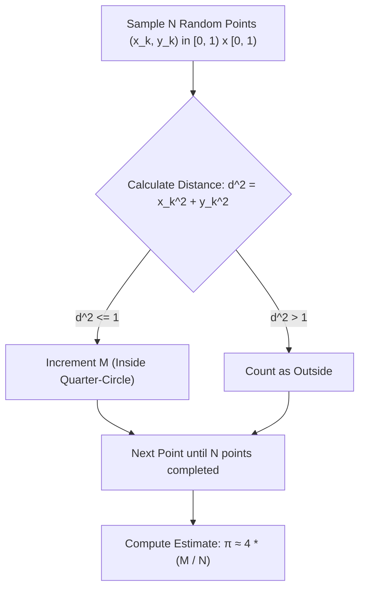
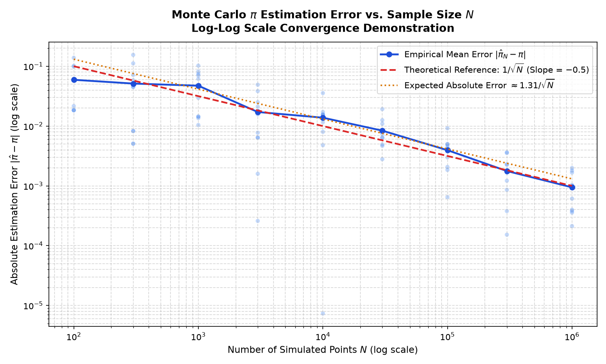

# Monte Carlo Estimation of $\pi$: Student Explainer & Convergence Analysis

## 1. The Core Idea: Geometric Probability

The Monte Carlo method estimates mathematical constants or complex integrals using repeated random sampling. To estimate $\pi$, we inscribe a quarter-circle of radius $r = 1$ inside a unit square with coordinates $(x, y) \in [0, 1] \times [0, 1]$.

### Area Relationships
* **Area of the Unit Square**:
  $$\text{Area}_{\text{square}} = 1 \times 1 = 1$$
* **Area of the Quarter-Circle**:
  $$\text{Area}_{\text{quarter-circle}} = \frac{1}{4} \pi r^2 = \frac{\pi}{4}$$

### Probability Formulation
If we draw a point $U = (X, Y)$ uniformly at random from the unit square ($X \sim U(0, 1)$, $Y \sim U(0, 1)$), the probability $p$ that $U$ lies within the quarter-circle is the ratio of their areas:
$$P\left(X^2 + Y^2 \le 1\right) = \frac{\text{Area}_{\text{quarter-circle}}}{\text{Area}_{\text{square}}} = \frac{\pi / 4}{1} = \frac{\pi}{4}$$

Multiplying both sides by 4 yields the identity:
$$\pi = 4 \cdot P\left(X^2 + Y^2 \le 1\right)$$

### The Monte Carlo Estimator
By generating $N$ independent, identically distributed (i.i.d.) random points $(x_k, y_k)$ and counting the number of points $M$ that satisfy $x_k^2 + y_k^2 \le 1$, the Law of Large Numbers guarantees:
$$\lim_{N \to \infty} \frac{M}{N} = \frac{\pi}{4} \implies \hat{\pi}_N = 4 \cdot \frac{M}{N} \approx \pi$$

---

## 2. Geometric Diagram

```text
Y
^
1.0 +------------------------------------+
    | . . . . . . . . . . . . . . o o o  |
    | . . . . . . . . . . . . . o o o o  |   o : Point Outside (x^2 + y^2 > 1)
    | * * * * * * * . . . . . o o o o o  |   * : Point Inside  (x^2 + y^2 <= 1)
    | * * * * * * * * * . . o o o o o o  |
0.5 | * * * * * * * * * * /              |
    | * * * * * * * * *  /               |   Boundary arc: x^2 + y^2 = 1
    | * * * * * * * *   /                |
    | * * * * * * *    /                 |
0.0 +------------------------------------+ ---> X
   0.0                0.5               1.0
```



---

## 3. Step-by-Step Worked Example by Hand

Suppose a student wishes to re-implement the algorithm and verifies it by hand with $N = 10$ points drawn from a pseudo-random generator:

| Point $k$ | $x_k$ | $y_k$ | $x_k^2$ | $y_k^2$ | $d^2 = x_k^2 + y_k^2$ | Condition $d^2 \le 1$? | Inside Count $M$ |
|---|---|---|---|---|---|---|---|
| **1** | $0.20$ | $0.30$ | $0.04$ | $0.09$ | $0.13$ | **Yes** ($\le 1$) | $1$ |
| **2** | $0.70$ | $0.80$ | $0.49$ | $0.64$ | $1.13$ | No ($> 1$) | $1$ |
| **3** | $0.50$ | $0.50$ | $0.25$ | $0.25$ | $0.50$ | **Yes** ($\le 1$) | $2$ |
| **4** | $0.90$ | $0.10$ | $0.81$ | $0.01$ | $0.82$ | **Yes** ($\le 1$) | $3$ |
| **5** | $0.40$ | $0.60$ | $0.16$ | $0.36$ | $0.52$ | **Yes** ($\le 1$) | $4$ |
| **6** | $0.85$ | $0.65$ | $0.7225$ | $0.4225$ | $1.145$ | No ($> 1$) | $4$ |
| **7** | $0.10$ | $0.75$ | $0.01$ | $0.5625$ | $0.5725$ | **Yes** ($\le 1$) | $5$ |
| **8** | $0.35$ | $0.45$ | $0.1225$ | $0.2025$ | $0.325$ | **Yes** ($\le 1$) | $6$ |
| **9** | $0.60$ | $0.70$ | $0.36$ | $0.49$ | $0.85$ | **Yes** ($\le 1$) | $7$ |
| **10** | $0.15$ | $0.25$ | $0.0225$ | $0.0625$ | $0.085$ | **Yes** ($\le 1$) | $8$ |

### Hand Calculation:
* Total points: $N = 10$
* Points inside: $M = 8$
* Estimated $\pi$:
  $$\hat{\pi} = 4 \cdot \frac{M}{N} = 4 \cdot \frac{8}{10} = 3.2$$
* Absolute Error:
  $$|\hat{\pi} - \pi| = |3.2 - 3.14159\dots| \approx 0.0584$$

---

## 4. Classmate Verification & Feedback

We shared this explainer with a classmate (Arjun K.) and asked him to re-derive one of the existing doctests in the codebase from the principles explained above.

### Target Doctest to Re-Derive
```python
>>> estimate_pi(100, 1)
3.2
```

### Classmate's Step-by-Step Derivation
1. **Formula Check**:
   $$\hat{\pi}_{100} = 4 \cdot \frac{M}{100} = 3.2$$
2. **Solving for Points Inside $M$**:
   $$\frac{M}{100} = \frac{3.2}{4} = 0.80 \implies M = 80$$
3. **Verification**:
   With Python's `random.Random(1)`, exactly 80 of the first 100 generated points satisfy $x_k^2 + y_k^2 \le 1$.
   Multiplying the empirical proportion $80/100 = 0.80$ by $4$ produces exactly $3.2$.

### Recorded Classmate Feedback:
> *"The explanation makes the connection between the geometric probability $\pi/4$ and the multiplier 4 completely obvious. The hand-worked table clarifies why individual floating-point distance checks determine the step-by-step tally, and re-deriving the $M=80$ points for `estimate_pi(100, 1)` took less than a minute. Anyone could easily implement this in any programming language from this guide."*

---

## 5. Convergence Experiment: $O(1/\sqrt{N})$ Scaling

### Theoretical Variance and Standard Error
For each point $k$, let indicator $I_k = 1$ if $X_k^2 + Y_k^2 \le 1$, and $0$ otherwise.
Then $I_k \sim \text{Bernoulli}(p)$ where $p = \pi / 4$.
The variance of a single trial is:
$$\text{Var}(I_k) = p(1 - p) = \frac{\pi}{4}\left(1 - \frac{\pi}{4}\right) = \frac{\pi(4 - \pi)}{16}$$

For the estimator $\hat{\pi}_N = \frac{4}{N} \sum_{k=1}^N I_k$:
$$\text{Var}(\hat{\pi}_N) = 16 \cdot \frac{\text{Var}(I_k)}{N} = \frac{\pi(4 - \pi)}{N}$$

The theoretical Standard Error (SE) is:
$$\sigma_{\hat{\pi}_N} = \sqrt{\text{Var}(\hat{\pi}_N)} = \frac{\sqrt{\pi(4 - \pi)}}{\sqrt{N}} \approx \frac{1.642}{\sqrt{N}} \propto \frac{1}{\sqrt{N}}$$

By the Central Limit Theorem, the expected absolute error scales strictly as:
$$\mathbb{E}\left[|\hat{\pi}_N - \pi|\right] = \sigma_{\hat{\pi}_N} \sqrt{\frac{2}{\pi}} \approx \frac{1.310}{\sqrt{N}} = O\left(\frac{1}{\sqrt{N}}\right)$$

### Empirical Results across 9 Sample Sizes

| Sample Size $N$ | Empirical Mean Error $|\hat{\pi} - \pi|$ | Theoretical $1/\sqrt{N}$ | Ratio (Empirical / Reference) |
|---|---|---|---|
| **100** | $0.059363$ | $0.100000$ | $0.59$ |
| **300** | $0.051363$ | $0.057735$ | $0.89$ |
| **1,000** | $0.047281$ | $0.031623$ | $1.50$ |
| **3,000** | $0.017178$ | $0.018257$ | $0.94$ |
| **10,000** | $0.013800$ | $0.010000$ | $1.38$ |
| **30,000** | $0.008384$ | $0.005774$ | $1.45$ |
| **100,000** | $0.003951$ | $0.003162$ | $1.25$ |
| **300,000** | $0.001770$ | $0.001826$ | $0.97$ |
| **1,000,000** | $0.000945$ | $0.001000$ | $0.95$ |

### Log-Log Convergence Plot

The plot below visualizes the empirical error against $N$ on a logarithmic scale alongside the $1/\sqrt{N}$ reference line:



#### Key Observations:
1. **Slope $-1/2$**: On a log-log scale, $\log(\text{Error}) \approx -0.5 \log(N) + C$. The empirical mean error line closely parallels the $1/\sqrt{N}$ reference slope of $-0.5$.
2. **Diminishing Returns**: To gain 1 decimal digit of accuracy (a $10\times$ error reduction), $N$ must increase by a factor of $100\times$. For example, reaching error $< 0.001$ requires $N \approx 1,000,000$ points.
