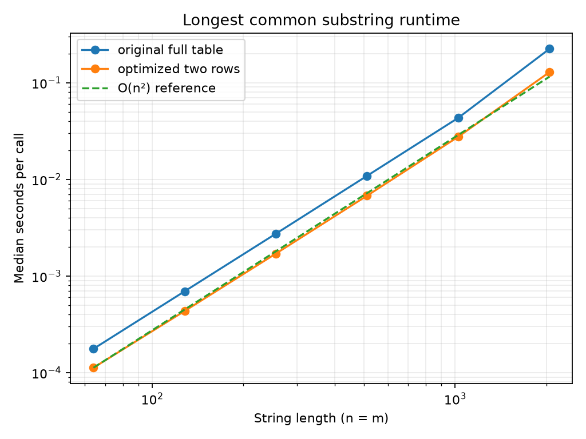

# Longest common substring: timing and memory

## Complexity

Let `n = len(text1)` and `m = len(text2)`. The algorithm compares each
character pair once, so both the original and optimized implementations take
O(n * m) time. The original implementation stores an `(n + 1) x (m + 1)` DP
table, which takes O(n * m) space. The optimized implementation puts the
shorter string on the row axis and keeps only the previous and current rows;
these each have `min(n, m) + 1` cells, so auxiliary space is O(min(n, m)).

For square inputs, the expected time curve is quadratic: doubling both string
lengths quadruples the number of character-pair comparisons.

## Timing evidence

`bench.py` used `timeit` with identical strings of each listed length. Each
number is the median seconds per call across three autoranged samples. The
reference column runs the original full-table algorithm; the two-row column
runs `longest_common_substring`.

| Length of each string | Original full table (ms/call) | Two rows (ms/call) |
|---:|---:|---:|
| 64 | 0.177 | 0.113 |
| 128 | 0.696 | 0.435 |
| 256 | 2.742 | 1.706 |
| 512 | 10.884 | 6.780 |
| 1,024 | 43.311 | 27.612 |
| 2,048 | 223.979 | 128.605 |

The measured curves follow the expected quadratic trend, with some deviation
from exactly 4x at each doubling due to runtime and allocation overhead. The
two-row implementation is also faster in these measurements, but the
optimization's guaranteed benefit is the lower auxiliary space.

## Peak-memory evidence

With two identical 2,000-character strings (`"a" * 2000`), measured using
`tracemalloc` in the same process:

| Version | Peak traced memory |
|---|---:|
| Original full-table reference | 77,900,240 bytes (74.29 MiB) |
| Two-row implementation | 126,456 bytes (0.12 MiB) |

The measured peak dropped by about 616x. The input strings are created before
tracing, so this measures memory allocated by the function call.

## Result preservation

`bench.py` checks that the optimized function returns the same substring as
the original reference on every valid example from the original and new
doctests. The module's invalid-input doctest remains unchanged. The full
doctest suite passes with 14 examples.
