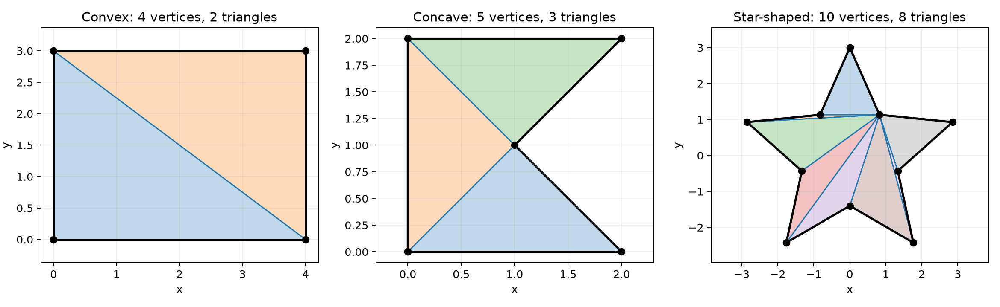

# Ear clipping: from polygon to triangles

Ear clipping turns a simple polygon into triangles without adding vertices. Keep
the polygon's vertices in their boundary order. At each iteration, examine a
vertex and its two neighbors. The corner is an *ear* if it is convex in the
polygon's winding direction and the triangle formed by those three points
contains no other polygon vertex. Emit that triangle, remove the middle vertex,
and continue with the smaller polygon. A simple polygon with `n` vertices
produces `n - 2` triangles; the implementation stops if it cannot find an ear,
so it assumes valid, non-self-intersecting input.

The implementation finds the polygon's orientation first. `is_ear` tests
candidate vertices by calling `is_convex`, then uses
`is_point_inside_triangle` to reject a candidate if any other vertex lies inside
or on its triangle. `triangulate_polygon` copies the input, scans around that
copy, appends the previous/current/next triangle, and removes the current
vertex. The original list is not modified.

## Worked example by hand

Use the five-vertex concave polygon
`A=(0,0), B=(2,0), C=(1,1), D=(2,2), E=(0,2)`, in that order. The inward
notch at `C` makes the polygon concave.

```text
E (0,2) ---------------- D (2,2)
|  \\                 //  |
|    \\    T2   T3  //    |
|      \\          //     |
|        C (1,1)          |
|      //   T1   \\\\      |
|    //            \\\\    |
A (0,0) ---------------- B (2,0)
```

1. `B` is convex and triangle `ABC` contains no other vertex, so clip `B` and
   emit `[(0,0), (2,0), (1,1)]`.
2. In the remaining polygon `A-C-D-E`, clip `A` and emit
   `[(0,2), (0,0), (1,1)]`.
3. The remaining vertices form the final triangle
   `[(0,2), (1,1), (2,2)]`.

There are five input vertices and three output triangles, matching `n - 2`.
The diagonal edges are `A-C` and `C-E`; together with the original boundary,
they cover the polygon without overlapping interiors.

## Matplotlib experiment

The experiment script triangulates a convex quadrilateral, the concave polygon
above, and a ten-vertex star-shaped simple polygon. The colored fills show the
individual output triangles; the dark outline shows each input boundary.



| Shape | Vertices | Triangles | Check |
| --- | ---: | ---: | --- |
| Convex quadrilateral | 4 | 2 | `4 - 2` |
| Concave polygon | 5 | 3 | `5 - 2` |
| Star-shaped polygon | 10 | 8 | `10 - 2` |

Reproduce the figure and counts from the repository root with:

```bash
PYTHONPATH=. uv run python work/R23-T036/experiment.py
```

## Peer re-derivation

@kurkurenishant was asked to derive why the worked polygon produces three
triangles and which vertex is clipped first, without running the code. The
[request is in PR #77](https://github.com/S-AI-Projects/TheAlgorithms-Python/pull/77#issuecomment-6917698910);
their feedback is pending and will be recorded here when received.
